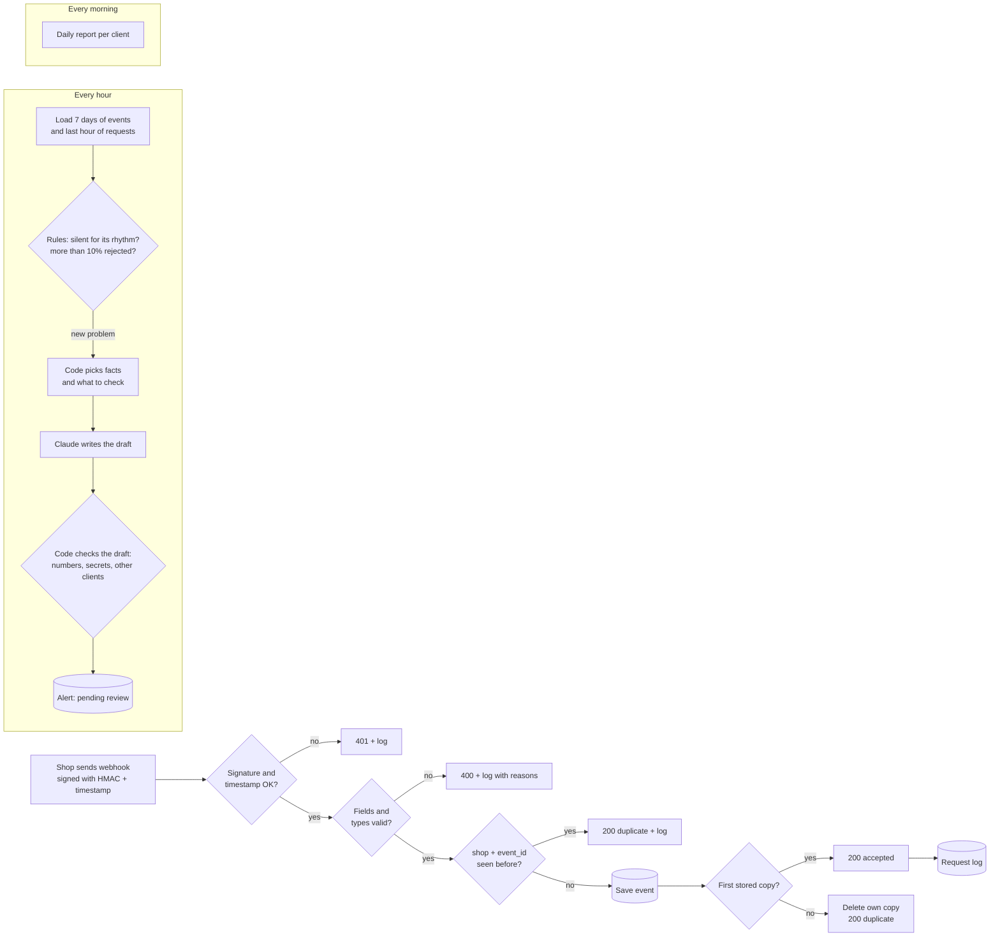

# Integration Health Monitor: catching silent webhook failures in n8n

A portfolio project using fictional data. A SaaS company receives webhooks from three fictional online shops. This project receives them safely and checks every hour whether an integration has gone quiet or started failing. When it finds a problem, it prepares a short message for the client and waits for a person to approve it.

**Built and tested, not deployed.** It runs on an n8n trial instance with fictional shops. It has never been used with a real client.

## At a glance

- **Webhook security:** HMAC-SHA256 on the raw body, 5-minute timestamp window, 64 KB size limit, idempotency that holds under parallel requests
- **Monitoring:** silence measured against each integration's own rhythm, plus an error-rate rule; 0 false alarms and 0 missed alerts in 18 scenarios
- **AI with guardrails:** rules decide, Claude only words the message, code checks the numbers, secrets and CSM rules, a person approves
- **Tests:** 45/45 signed requests against the live webhook, 18/18 detector scenarios, 14/14 draft checks; what failed first is documented below

## Problem

Integrations rarely fail loudly. A store changes a plugin, rotates a secret or moves to a new domain, and events simply stop arriving. Nothing errors on our side, because nothing reaches us. The client finds out days later, from their own numbers.

I saw this at work: an automation stopped sending without any error, and 0 of 28,496 recipients got the message before anyone noticed. This project is the system I would want in place for that kind of failure.

## What it does

1. **Receives webhooks safely.** Refuses bodies over 64 KB (413) before doing any work, then checks an HMAC-SHA256 signature over the raw body and a timestamp (rejects anything older than 5 minutes or more than 5 minutes in the future). A bad signature gets 401 and a log entry.
2. **Validates the payload.** Required fields and types, with every problem listed. A bad payload gets 400 and a log entry with the reasons.
3. **Ignores duplicates, even parallel ones.** The same shop + `event_id` is processed only once (idempotency). Repeats get 200 and are only logged. If identical requests arrive at the same moment, a check after saving keeps only the first copy.
4. **Stores and answers fast.** A valid event is saved, then the sender gets 200. The log is written after the answer.
5. **Detects silence and error spikes every hour.** Each integration is compared with its own normal rhythm. A second rule fires when more than 10% of requests in the last hour were rejected.
6. **Drafts a message for the CSM.** Rules find the problem. Claude writes a short English draft (what happened, what to check, next step). Code checks the draft, and the alert waits as `pending review`. Nothing is sent to the client.
7. **Writes a daily health report**, one line per client.

## How it works

### Signature scheme

The shop sends three headers:

| Header | Example | Meaning |
| --- | --- | --- |
| `X-IHM-Shop` | `shop_mossbank` | which shop, so we know which secret to use |
| `X-IHM-Timestamp` | `1794251064` | Unix seconds when the request was signed |
| `X-IHM-Signature` | `v1=<64 hex characters>` | HMAC-SHA256 of `"<timestamp>.<raw body>"` with the shop's secret |

The signature covers the timestamp, so the timestamp cannot be changed. The comparison is constant-time. Each shop has its own secret, stored only in n8n Variables (`IHM_SECRET_<SHOP>`). This repository contains only the variable names.

### Idempotency that holds under parallel requests

A lookup before saving catches normal retries. It cannot catch two identical requests that arrive at the same moment, because both look before either has saved. My first test run showed exactly this. So after saving, the workflow reads all rows with the same shop + `event_id` again. The row with the lowest id wins, and any later copy deletes itself and answers 200 `duplicate`. Test D06 sends the same signed request three times at once: one is accepted, two are answered as duplicates, and one row is stored.

### Silence detector

A fixed rule such as "alert after 1 hour of silence" does not work, because shops have different rhythms. For each integration:

- take the gaps between its events over the last 7 days
- the usual gap is the 90th percentile of those gaps
- alert when it has been quiet for more than 3 × the usual gap, with a floor of 60 minutes
- fewer than 20 events means the rhythm is still being learned, so no silence alert
- no events at all in 7 days always alerts

### Error-spike rule

In the last 60 minutes, rejected ÷ (accepted + rejected). Alert when the rate is above 10% and there were at least 10 requests. Duplicates are normal retries, so they do not count as errors.

### Alerts and the AI step

- **No AI in the decision.** Rules decide whether there is a problem, so every alert can be explained.
- **Code chooses the content.** It picks the facts (numbers) and what the client should check, for example "was the signing secret changed?" when most rejections are signature failures.
- **Claude only writes the wording.** It receives the facts and the checks, never secrets or other clients' data.
- **Code checks the draft.** Every number must come from the facts, the main number must be there, there must be no secret or key-like string and no other client's name, and the length must be reasonable. It also blocks CSM mistakes: promising a fix or a deadline, asking for a call, or offering free work or a discount. If a secret or key-like string is found, the draft is removed and the check notes quote none of it.
- **A person approves.** Alerts are saved as `pending review`. The same problem does not create a new alert for 6 hours, so a second run makes no AI calls.

## Test results

Two test workflows run the real code, and I set every expected answer before running them.

| Test | First run | Final run |
| --- | --- | --- |
| Webhook intake: 45 signed requests sent to the live webhook URL (valid, bad signature, old or future timestamp, missing field, wrong type, oversized body, duplicate, replay, 3 identical requests at once) | 38 of 43 | **45 of 45** |
| Silence and error-spike detector: 18 scenarios | 18 of 18 (results not saved, see below) | **18 of 18** |
| False alarms / missed alerts in those 18 scenarios | 0 / 0 | **0 / 0** |
| Draft checks: 14 good and bad drafts | 10 of 10, but a leak found (see below) | **14 of 14** |
| Demo run: 3 shops (healthy, silent, error spike) | 2 correct alerts, 0 false alarms | same |
| Second monitor run right after the first | 0 new alerts, 0 AI calls | same |

Details per case: `test_results_intake.csv`, `test_results_monitor.csv` and `test-results.md`.

These are tests on fictional data with expected answers I chose. They show that the rules and checks behave as designed. They do not show how well the thresholds would work on real traffic.

## What did not pass the first time

- **Duplicates arrived before the original (V03/D04, D01/D02).** The test workflow sent requests in parallel, so a "duplicate" sometimes arrived first and the original was treated as the duplicate. The intake behaved correctly for the order it received. I changed the test to send one request at a time. This also shows a real limit, described below.
- **Broken JSON was rejected with 401 instead of 400 (F11).** The n8n HTTP Request node re-encodes a body that is sent as `application/json` but is not valid JSON, so the bytes that arrived were not the bytes that were signed. The intake was right to reject it. The test now sends that one body as `text/plain`.
- **Timestamps aged while waiting.** All requests were signed at the start, and some waited about 10 seconds before being sent. Each request is now signed just before it is sent.
- **Secret digits in the check notes.** When a test draft contained the real signing secret, the check blocked it but its note "numbers not in the facts" listed digits taken from the secret. The note no longer lists numbers when a secret or key is found, the draft is removed before saving, and the test now fails if any part of the secret appears in the notes.
- **Test results not saved on the first monitor run.** The results table was missing two columns (`false_alarms`, `missed`). I added them.

## Improvements after the first version

After all tests passed, I reviewed the project for weak points and added three things:

- **Parallel duplicates.** The first test run had shown that two identical requests at the same moment could both pass the duplicate lookup. Added the check after saving described above, and test D06 (3 copies at once). In the final run both extra copies were caught by that new check.
- **Body size limit.** Bodies over 64 KB now get 413 before signature work, so a flood of huge requests costs little. Test F15.
- **CSM rules in the draft check.** Drafts that promise a fix or a deadline, ask for a call, or offer free work are blocked. Tests C11–C13, plus C14 to make sure "feel free to reply" is not blocked.

## Limits

- **Duplicates are resolved after saving, not prevented by the database.** For a moment two copies can exist before the later one deletes itself. In production I would use a unique constraint on shop + `event_id` in a real database. n8n Data Tables do not support one.
- **One secret per shop, no rotation.** A real setup would accept two secrets for a short time while a shop rotates its secret.
- **The `X-IHM-Test-Run` header** marks test traffic so the monitor ignores it. It is not signed, so a real deployment would remove it or restrict it.
- **Silence rule has no time-of-day pattern.** A shop that is quiet every night may need a night-time profile. The 7-day percentile helps, but it is not a full seasonal model.
- **The daily report has no automated tests.** It was checked on one demo run (3 shops, results in `sample-results.md`).
- **Thresholds were not tuned on real traffic.** 3 × the usual gap, the 60-minute floor and 10% are reasonable starting points.
- **Fictional data only.** Shops, events and secrets are made up. Nothing comes from my current job.
- Test executions in n8n keep request data, including test signatures. A real deployment needs retention settings.

## Files

- `IHM Webhook Intake.json`: receives, verifies, validates, deduplicates and stores webhooks
- `IHM Health Monitor.json`: hourly silence and error-spike detection, AI draft, draft checks, review queue
- `IHM Daily Health Report.json`: one report line per client per day
- `IHM Intake Tests.json`: sends 45 test cases as signed requests and compares the results
- `IHM Monitor Tests.json`: 18 detector scenarios and 14 draft-check cases
- `IHM Demo Data.json`: loads a fictional 7-day history for the three shops
- `intake_test_cases.csv`: the 45 intake cases with expected results
- `test_results_intake.csv`, `test_results_monitor.csv`: final test runs, case by case
- `test-results.md`: test method, all runs and what changed between them
- `sample-results.md`: the two alerts and drafts from the demo run, and the daily report
- `data-and-privacy.md`: tables, payload contract and data protection notes
- `JAK_TO_DZIALA.md`: plain-language explanation in Polish, with interview questions

## How to import

1. Create these n8n data tables (columns are listed in `data-and-privacy.md`): `IHM Events`, `IHM Request Log`, `IHM Integrations`, `IHM Alerts`, `IHM Daily Reports`, `IHM Intake Cases`, `IHM Test Results`. Import `intake_test_cases.csv` into `IHM Intake Cases` and add the three shops to `IHM Integrations`.
2. Create three n8n Variables: `IHM_SECRET_MOSSBANK`, `IHM_SECRET_QUILLMOOR`, `IHM_SECRET_TALLOWICK`, each a long random string.
3. Import the six workflow JSON files and select your own data tables in the data table nodes and an Anthropic credential in `Write client draft`.
4. In `IHM Intake Tests`, set `WEBHOOK_URL` in `Build test requests` to your instance. In `IHM Monitor Tests`, select `IHM Health Monitor` in both Execute Workflow nodes.
5. Publish `IHM Webhook Intake`, then run the test workflows.

## Tools

- n8n: Webhook, Code (JavaScript, Node `crypto`), Data Tables, Schedule, Execute Workflow, HTTP Request
- Anthropic Claude Haiku for the draft wording
- Claude for AI-assisted building, review and testing

## My role

I built this project with AI assistance. I defined the scenario, the signature and timestamp rules, the idempotency key, the silence and error-spike rules, what the client should check for each problem, and the draft checks. I set the expected answer for every test case, reviewed the failures and chose the fixes.
